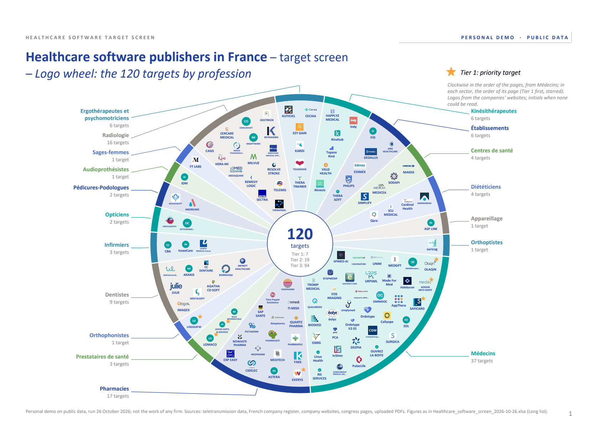
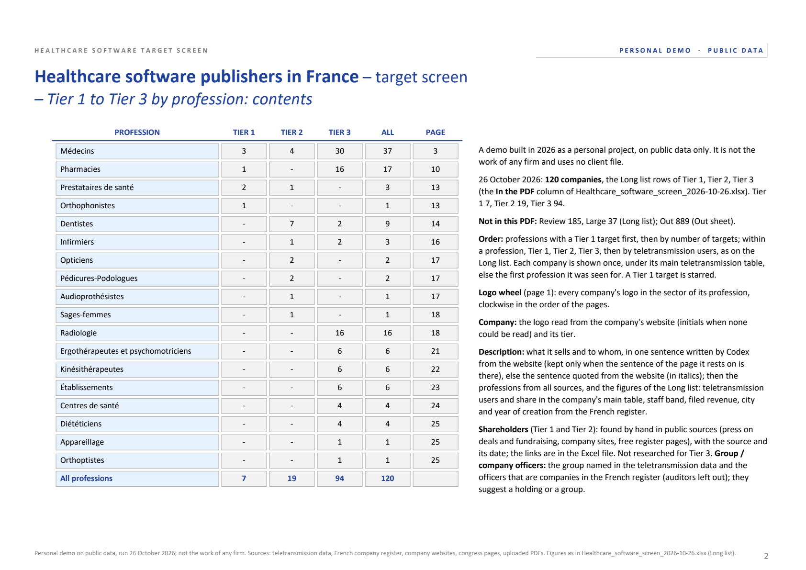
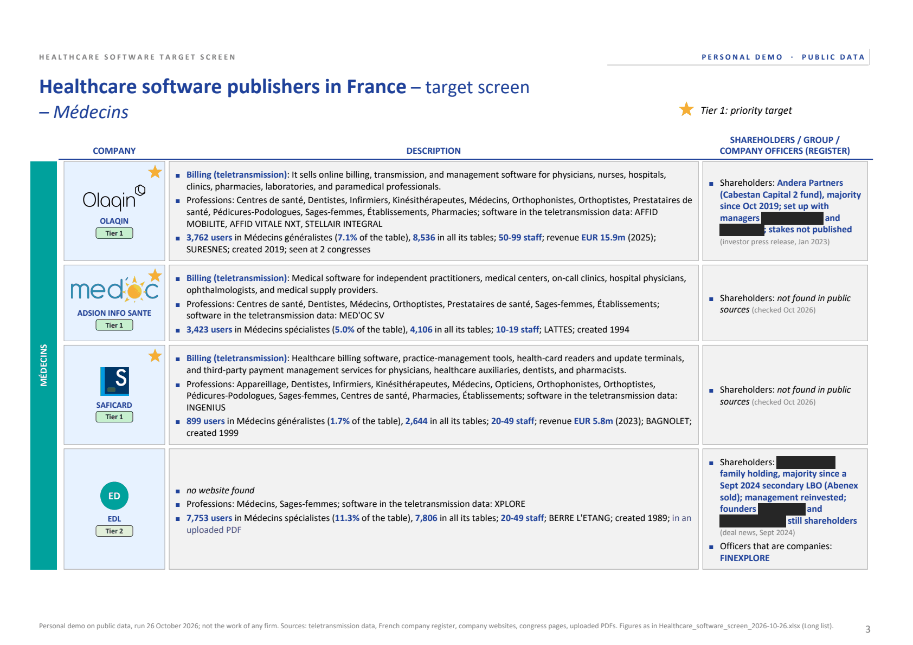
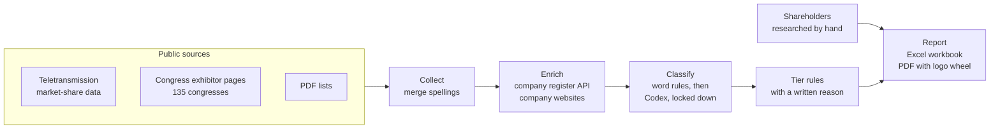

# Healthcare Software Target Screen: France

## Objective

My goal was to map the French market for healthcare practice software (the programs that
doctors, nurses, pharmacists and other health professionals use to run their practice and bill
the national health insurance) and to find the publishers that could be acquisition targets for
a buy-and-build strategy. The market is fragmented: hundreds of publishers, many of them small
and strong in a single profession. No public list ranks them, and the useful facts (who uses
which software, how large each company is, who owns it) are spread across public sources that
do not talk to each other.

The project shows how a small investment team could screen such a market from public data
only: Python does the collecting, matching and first reading, an AI model reads only what the
rules cannot settle, and a person does the judgement.

## Approach

I built a data pipeline in Python that:

1. collects company names from public sources: national teletransmission market-share data
   (which billing software each profession uses, and how many professionals use it), the
   exhibitor and partner pages of 135 medical congresses, and PDF lists such as exhibitor
   catalogues;
2. merges the spellings of each company and matches it to the French company register
   (identifier, activity, staff, revenue, officers);
3. finds and reads each company's website, with word rules first and an AI model (Codex,
   locked down) for the unclear cases;
4. applies plain tier rules and writes an Excel workbook and a PDF report from the same rows.

## Features

- **Long list (Excel).** One row per company: its tier and the reason in words, its position in
  the market-share data, the evidence sentence from its website, register data, and yellow
  columns to fill by hand. The summary sheet is built from formulas on the other sheets.
- **Market concentration.** For each profession: number of publishers, the top publisher's
  share, the top three's share and the HHI.
- **Review list.** Everything a person must check, with the evidence: unclear websites, weak or
  tied register matches, AI answers whose quote is not on the page.
- **PDF report.** A logo wheel of the 120 targets by profession, a contents page, then one row
  per company: its logo, a one-sentence description written by the AI from the website (kept
  only when the sentence it rests on is on the page), its figures, and its shareholders
  researched by hand.
- **Re-runnable stages.** Each stage saves its results, so a threshold can change and the report
  be rebuilt in seconds without reading the web again.

[Sample: the Tier 1 and Tier 2 rows](samples/tier-1-and-tier-2.md) ·
[Sample: AI answers and the quote check](samples/codex-answers.md)

<table>
  <tr>
    <td width="50%"></td>
    <td width="50%"></td>
  </tr>
  <tr>
    <td>Page 2: targets by profession and tier, with the method notes</td>
    <td>Page 3: one row per company (names of private individuals hidden)</td>
  </tr>
</table>

## Key findings

From the run of 26 October 2026.

- **Most names are noise.** 1,231 company names were collected; 889 were dropped (not a company,
  not a software publisher, a duplicate, or no trace in the register or on the web), 342 made the long list
  and 120 were ranked in three tiers, 7 of them in Tier 1.
- **Fragmentation differs sharply by profession.** Software for specialist doctors is spread
  across 36 publishers, and the top three hold 37% of its users; podiatry has 17 publishers and a
  top three of 40%. Pharmacies have 5 publishers and a top three of 87%, physiotherapists 18
  publishers and a top three of 88%. The room for consolidation looks largest in the first group.
- **Small leaders exist.** Some Tier 1 companies lead their niche with fewer than 100 staff: one
  holds 34% of speech therapists (7,374 users) with 20 to 49 staff, another 37% of pharmacies
  (7,373 users) with 50 to 99 staff.
- **Consolidation is already under way.** Public sources named the shareholders of 14 of the 27
  Tier 1 and Tier 2 companies researched. Only one of those 14 has no outside investor and no
  parent group reported; the others belong to investment funds, family holdings or larger groups. In dental
  software, three publishers merged in June 2026 inside a fund-backed group.
- **The register's officers are not enough to call a company founder-owned.** Tier 1 requires
  that no company sits among the officers, yet hand research showed that 3 of the 7 Tier 1
  companies belong to an investment fund or a group (one of them owns 99% of another).
- **The AI is mostly used to rule companies out.** Of the 441 websites the rules could not
  settle, Codex read 372 as not a publisher (drug makers, device makers, distributors, media) and
  53 as publishers; 11 answers (2.5%) quoted a sentence that was not on the page and were flagged
  for review.

## Architecture

- The pipeline is plain Python. Each stage reads what the previous one saved, so any stage can
  be run again alone.
- Web access is polite: robots.txt is respected, there is one request per second per site, and
  every page is read once and cached.
- AI is used only for language tasks: reading the websites the rules cannot settle, and writing
  a one-sentence description of each company in the PDF. It runs through the Codex CLI with a
  ChatGPT login, with no tools, no web access, a read-only sandbox and an empty work folder, and
  it must answer in a fixed JSON format.
- The Excel file and the PDF are written from the same rows: the PDF shows exactly the long-list
  rows of its tiers, with the same figures, and a test checks it.

## Challenges and solutions

- **Data behind a JavaScript page.** The market-share page draws its tables in the browser, so
  there is nothing to read in its HTML. I found the data request behind it: 7.7 MB of JSON,
  labelled as HTML, with one line per month, profession and software since 2019. The screen keeps
  the latest month and drops the total and "other publishers" lines, which stay in each table's
  total.
- **Every congress site is different.** The 135 congresses each have their own layout: logos,
  link lists, tables, PDF floor plans. A generic reader handles the common layouts and filters
  out page furniture (menus, cookie notices, stand numbers, social links). Every page tried is
  logged with the reason it gave no names: only 20 of the 59 exhibitor pages tried gave names,
  because past editions are taken down and some lists are drawn with JavaScript or as images.
- **Namesakes in the company register.** The register is searched by name, so it returns
  namesakes: a car wash for one software company, a dental practice for a dental-software
  publisher, a closed company with a near spelling. Candidates are scored; weak matches and ties
  go to review with the runner-up; known publishers are searched among software activity codes
  first; and 12 identifiers were set by hand after checking legal notices, merger notices and the
  companies' own websites. Of 1,182
  names checked, 504 matched with confidence, 261 were ties, 76 were weak and 329 were not found.
- **Guessing websites.** When no link is known, the screen guesses `www.<name>.fr` and `.com`. A
  guess is kept only if the page names the company, uses health vocabulary and is not a parked
  domain. `vega.com`, a maker of sensors whose clients include drug makers, would pass a
  one-word health check for a software publisher named VEGA, so a guess for a known publisher
  needs two different health words. A guess that redirects to
  another site must still carry the company's or its group's name. 549 of 998 websites were found.
- **An AI reading untrusted pages.** Website text can contain anything, including instructions.
  The model gets no tools at all (no shell, browser, web search or connectors), works in an empty
  folder and can only answer in the JSON format. It must copy one sentence from the page to
  justify its answer, and the script checks that the sentence is really there. Answers are
  cached, so a re-run never asks the same question twice. The same check applies to the PDF
  descriptions: 2 of the 110 written were dropped because their sentence was not on the page.
- **Who owns whom.** The free register lists officers, not shareholders, and the register of
  beneficial owners has been closed to the public since 2024. Officers that are companies flag a
  holding or a group; the shareholders of the Tier 1 and Tier 2 companies were researched by hand
  in press releases, legal notices and deal news, each with its source and date.
- **Privacy.** The published pages hide the names of private individuals (founders, managers,
  family owners), and the shareholder file stays private.

## Working principles

- **Rules before AI.** Word rules settle the clear cases for free and explain themselves; the AI
  reads only the rest.
- **Evidence or review.** Every decision keeps a sentence from its source, and anything unsure
  is listed for a person to check.
- **Plain, visible rules.** Tiers come from a short function with a written reason for each
  company, and every threshold is printed in the workbook.
- **Testing against reality.** 45 offline tests run on invented data, and results are checked
  against the sources, for example each identifier set by hand against a legal or merger notice.
- **One set of rows.** The Excel file and the PDF come from the same rows, so they cannot
  disagree.

## Repository contents

- `figures/`: pages 1 to 3 of the PDF report of 26 October 2026 (names of private individuals
  hidden).
- `samples/`: the Tier 1 and Tier 2 rows of the long list, and examples of the AI's answers with
  the quote check.
- `code/`: abridged copies of four modules. The core logic is shown in full; source-specific
  parts are marked `[omitted]`, and source names are replaced by generic terms.
  - `tiering.py`: the tier rules, each tier with its written reason.
  - `classify.py`: the word rules, the locked-down Codex call, the prompts and the quote check.
  - `matching.py`: merging spellings, scoring register matches and merging names that share an
    identifier.
  - `websites.py`: guessing and checking each company's website.

The rest of the screener remains private: the source connectors and the congress list, the
Excel and PDF report generators, the configuration, the tests and the run data.

## Stack

Python (requests, BeautifulSoup, pdfplumber, openpyxl, reportlab) · Codex CLI with a ChatGPT
login, locked down · unittest.

## Timeline

- 22 Oct 2026: market-share data request found; first full runs and Excel long list
- 25 Oct: PDF lists as an input, AI-written descriptions, PDF report with the logo wheel
- 25 to 26 Oct: 12 identifiers set by hand, shareholders researched, final report

## About

A personal project built in 2026 on public data only. It is not the work of any firm, does not
represent any firm's views and uses no client file. Figures are as of October 2026 and may be out
of date.
